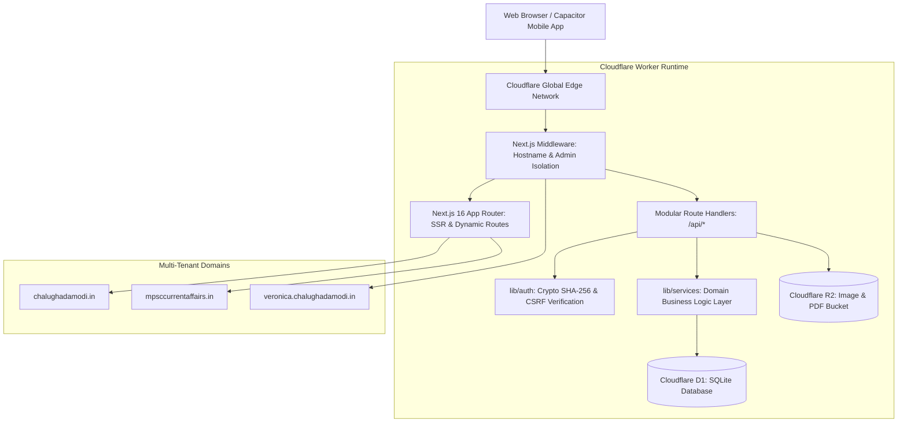

# System Architecture Documentation

## 1. High-Level Architecture Overview

Chalu Ghadamodi utilizes a modern, edge-native Jamstack architecture deployed on **Cloudflare Workers** via `@opennextjs/cloudflare`. The system combines server-side rendering (SSR) for search engine crawlers with an instant edge-cached API and persistent storage in Cloudflare D1 (Serverless SQLite) and Cloudflare R2 (Object Storage).



---

## 2. Directory & Code Organization

```
├── app/                        # Next.js 16 App Router
│   ├── [keyword]/              # Dynamic canonical SEO landing hubs (48 routes)
│   ├── about/                  # About Us page
│   ├── admin/                  # Administrative CMS Portal (isolated to veronica.*)
│   ├── api/                    # Modular API route handlers
│   │   ├── admin/              # Authenticated CRUD endpoints (announcements, faqs, etc.)
│   │   ├── images/             # Secure R2 media delivery endpoint
│   │   └── public/             # Public content aggregator (/api/public/content)
│   ├── budgetform/             # Budget submission embed page
│   ├── privacy-policy/         # Dedicated privacy policy page
│   ├── robots.txt/             # Dynamic host-specific robots.txt route handler
│   ├── sitemap.xml/            # Dynamic host-specific XML sitemap route handler
│   ├── layout.tsx              # Root HTML layout, SEO meta tags, scripts & schemas
│   └── page.tsx                # High-speed SSR homepage
│
├── components/                 # Presentation & UI Layer
│   ├── admin/                  # Reusable CMS data table & form components (AdminCrudPage)
│   ├── sections/               # Modular homepage & landing page sections
│   │   ├── Announcements.tsx   # Top banner carousel
│   │   ├── DailyUpdates.tsx    # Dated editorial news stories (with NewsArticle schema)
│   │   ├── FAQ.tsx             # Interactive accordion (with sanitized HTML & FAQPage schema)
│   │   ├── Footer.tsx          # Clean footer navigation & social links
│   │   ├── Gallery.tsx         # Job recruitment cards with live deadline tracking
│   │   ├── Hero.tsx            # Hero banner & quick search
│   │   ├── Magazine.tsx        # PDF magazine download grid
│   │   ├── StaticGS.tsx        # Static general studies syllabus revision modules
│   │   ├── StickyHeader.tsx    # Touch-friendly navigation header & profile modal
│   │   ├── Testimonials.tsx    # Student reviews & success stories
│   │   └── Tests.tsx           # Weekly mock test cards
│   └── ui/                     # Primitives (buttons, cards, badges, dialogs via shadcn)
│
├── lib/                        # Business Logic, Data Access & Services Layer
│   ├── api/                    # API response utilities & error formatting
│   │   └── response.ts         # apiSuccess, apiError, apiUnauthorized, apiRateLimited
│   ├── config/                 # Centralized configuration & environment settings
│   │   └── index.ts            # APP_CONFIG: domains, auth, uploads, external URLs
│   ├── services/               # Decoupled Domain Services (Business Logic)
│   │   └── content.service.ts  # Generic EntityService, AnnouncementService, FAQService, etc.
│   ├── auth.ts                 # Cryptographic SHA-256 tokens, timing-safe checks, rate limiting
│   ├── db.ts                   # D1 and R2 Cloudflare context bindings & row mappers
│   ├── seo-keywords.ts         # Canonical high-yield SEO keyword directory (48 keywords)
│   ├── types.ts                # TypeScript domain models and CMS interfaces
│   └── utils.ts                # Tailwind class merging (cn utility)
│
├── android/                    # Native Android project (Capacitor + Gradle)
├── ios/                        # Native iOS project (Capacitor + Swift Package Manager)
├── dist-mobile/                # Compiled mobile app distribution artifacts (.apk, .app, .zip)
├── migrations/                 # D1 SQLite database schema migrations
├── next.config.ts              # Security headers, 301 redirects, Turbopack, and build configs
└── wrangler.jsonc              # Cloudflare Workers configuration (D1, R2, assets, routes)
```

---

## 3. Data Flow & Service Layer Decoupling

To ensure separation of concerns, the application strictly adheres to a three-tier architecture:

1. **Presentation Layer (`components/` & `app/**/page.tsx`)**:
   - Focuses solely on rendering HTML/JSX and managing local UI state.
   - Contains no direct SQL queries or database bindings.
2. **Controller / Route Handler Layer (`app/api/**/route.ts`)**:
   - Validates HTTP methods, verifies CSRF headers, and checks admin session credentials.
   - Delegates business operations directly to `lib/services/`.
   - Returns uniform responses via `lib/api/response.ts`.
3. **Service & Data Layer (`lib/services/` & `lib/db.ts`)**:
   - Manages business rules, input sanitization, column whitelisting, and query execution.
   - Maps raw D1 rows into typed domain entities (`lib/types.ts`).

---

## 4. Multi-Tenant Domain Isolation

The application dynamically detects the requesting host via `x-forwarded-host` and `host` headers:
- `chalughadamodi.in`: Renders primary branding, self-referencing canonical tags, and host-isolated `/sitemap.xml` containing only `chalughadamodi.in` URLs.
- `mpsccurrentaffairs.in`: Renders identical content under its secondary identity, with self-referencing canonicals and `/sitemap.xml` containing only `mpsccurrentaffairs.in` URLs.
- `veronica.chalughadamodi.in`: Reserved exclusively for administrative access (`/admin/*` and `/api/admin/*`), strictly guarded by `middleware.ts`.
